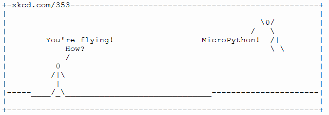

==============================
antigravity love this modules
==============================

| Antigravity, love and this modules are easter-egg features.
| Use the REPL and press Ctrl+D (or the reset button) to see the output from the print function after flashing to the microbit.

----------------
antigravity
----------------

| The ``antigravity`` module has no practical purpose.
| Use the REPL and press the reset button (or Ctrl+D in the REPL) to see the printout after flashing to the microbit.

.. code-block:: python

    from microbit import *
    import antigravity

----

----------------
love
----------------

| The ``love`` module has limited practical purpose.

.. py:function::  love.badaboom()

    Pulse the heart image 7 times.

.. code-block:: python

    from microbit import *
    import love

    love.badaboom()

----

----------------
this
----------------

| The ``this`` module has no practical purpose.

.. py:function::  this.authors()

    Prints the authors of MicroPython for the micro:bit.

| Use the REPL and the reset button to see the printout after flashing to the microbit.
| ``this.authors()`` prints the names itself, so it does not need to go inside ``print()``.

.. code-block:: python

    from microbit import *
    import this

    this.authors()
